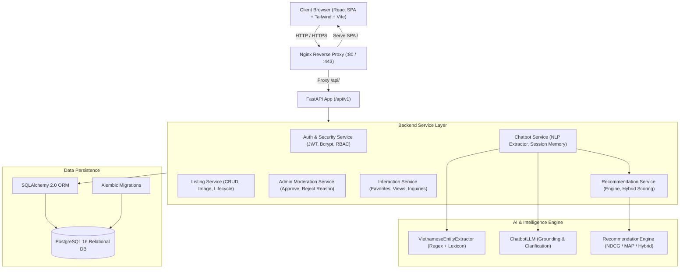

# KIẾN TRÚC HỆ THỐNG (SYSTEM ARCHITECTURE)
Dự án: **Thiết Kế và Phát Triển Hệ Thống Kinh Doanh Bất Động Sản Tích Hợp Chatbot và Hệ Thống Gợi Ý Thông Minh**

---

## 1. Tổng quan Công nghệ (Technology Stack)

| Tầng hệ thống | Công nghệ sử dụng | Mục đích chính |
| :--- | :--- | :--- |
| **Frontend** | React 18, TypeScript, Vite, Tailwind CSS, Lucide Icons | Giao diện SPA hiệu năng cao, responsive trên di động/desktop |
| **Web Server / Proxy** | Nginx 1.25 Alpine | Reverse proxy, static asset caching, Gzip compression, SSL TLS |
| **Backend API** | Python 3.10+, FastAPI, Pydantic v2 | Xây dựng REST API chuẩn hóa, bất đồng bộ và kiểm tra kiểu chặt chẽ |
| **ORM & Migration** | SQLAlchemy 2.0, Alembic | Quản lý quan hệ thực thể, migration phiên bản DB không gián đoạn |
| **Cơ sở dữ liệu** | PostgreSQL 16 Alpine | Lưu trữ quan hệ ACID, hỗ trợ đánh chỉ mục B-tree, Gin và Trigram |
| **Hệ thống AI & NLP** | Thuật toán Content-based + Hybrid Scoring, Deterministic Vietnamese NLP Extractor, LLM Tool Calling | Trích xuất thực thể tiếng Việt, gợi ý cá nhân hóa và sinh hội thoại chống ảo giác |
| **Container & CI/CD** | Docker, Docker Compose Multi-Stage | Chuẩn hóa môi trường phát triển và triển khai máy chủ/VPS |
| **Kiểm thử tự động** | Pytest (Backend 67 tests), Vitest (Frontend 10 tests) | Đảm bảo tính toàn vẹn 100% khi tái cấu trúc và bổ sung chức năng |

---

## 2. Mô Hình Kiến Trúc Phân Lớp (Layered Architecture)

---

## 3. Kiến Trúc Dữ Liệu & Thực Thể Quan Hệ (ERD)

Hệ thống bao gồm 10 bảng quan hệ chính được thiết kế chuẩn hóa bậc 3 (3NF):

1. **`users`**: Tài khoản người dùng (id, email, password_hash, full_name, phone_number, role, is_active, avatar_url, created_at, updated_at).
2. **`categories`**: Danh mục bất động sản (id, name, slug, description).
3. **`listings`**: Tin đăng bất động sản (id, user_id, category_id, title, description, price, price_unit, area, bedrooms, bathrooms, direction, legal_status, address_text, province, district, ward, latitude, longitude, transaction_type, status, published_at, expired_at, view_count, created_at, updated_at).
4. **`listing_images`**: Ảnh đính kèm (id, listing_id, image_url, public_id, is_thumbnail, display_order, created_at).
5. **`listing_features`**: Tiện ích căn nhà (id, listing_id, feature_name).
6. **`listing_moderation_logs`**: Nhật ký kiểm duyệt của Admin (id, listing_id, admin_id, action, reason, created_at).
7. **`favorites`**: Danh sách yêu thích của người dùng (id, user_id, listing_id, created_at).
8. **`inquiries`**: Yêu cầu tư vấn/liên hệ gửi tới chủ tin (id, listing_id, user_id, full_name, phone_number, email, message, status, created_at).
9. **`user_view_histories`**: Lịch sử xem phục vụ thuật toán gợi ý (id, user_id, listing_id, view_duration_seconds, created_at).
10. **`chat_sessions` & `chat_messages`**: Lưu trữ lịch sử hội thoại của Chatbot AI (id, user_id, session_title, message_text, structured_data, sender, created_at).

---

## 4. Cơ Chế Bảo Mật & Phân Quyền (RBAC & Security)

- **Nguyên tắc Zero-Trust đối với Frontend:** Backend không bao giờ tin tưởng quyền hạn (`role`) hoặc trạng thái do client tự gửi. Mọi token JWT đều được giải mã và kiểm tra trên database.
- **Dependency Injection Guard:** 
  - `get_current_active_user`: Yêu cầu token hợp lệ và tài khoản chưa bị khóa (`is_active = True`).
  - `require_admin_role`: Chặn 403 Forbidden nếu user không mang role `ADMIN`.
- **Chống lộ thông tin nhạy cảm:**
  - Password được mã hóa bằng thuật toán `bcrypt` với muối ngẫu nhiên (salt).
  - Không bao giờ trả về trường `password_hash` trong bất kỳ schema Pydantic nào.
  - Lỗi máy chủ (500) được bọc trong bộ lọc exception chuẩn hóa, ẩn hoàn toàn stack trace khỏi response client.
- **Bảo vệ chống Brute-Force:** Rate limiting hạn chế số lần thử đăng nhập sai liên tiếp.
